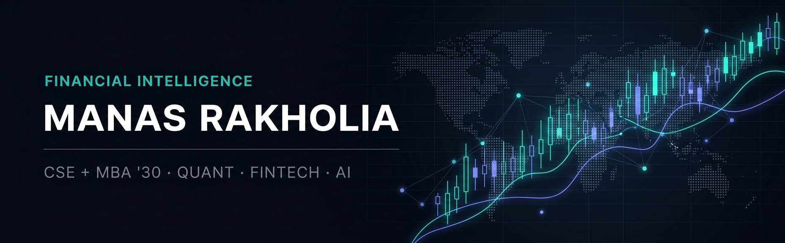

<div align="center">
  
</div>

<div align="center">
  <br />
  
</div>

<div align="center">
  <a href="mailto:rakholiamanas7@gmail.com"></a>
  <a href="https://github.com/MRMANASRAKHOLIA"></a>
  <a href="https://instagram.com/ynk.mns"></a>
  
</div>

<div align="center">
  <a href="#-about"><b>About</b></a> &nbsp;·&nbsp;
  <a href="#-what-im-building"><b>Work</b></a> &nbsp;·&nbsp;
  <a href="#-tech-stack"><b>Stack</b></a> &nbsp;·&nbsp;
  <a href="#-github-analytics"><b>Analytics</b></a> &nbsp;·&nbsp;
  <a href="#-education"><b>Education</b></a> &nbsp;·&nbsp;
  <a href="#-connect"><b>Connect</b></a>
</div>

---

## 🎯 About

> **I build decision systems for money and for the planet.**
> Quantitative thinking, explainable machine learning, and production-grade engineering — applied to financial risk, market intelligence, and satellite-scale environmental monitoring.

I'm an **Integrated B.Tech (CSE) + MBA** student at **Nirma University** — deliberately trained on both sides of the table: the **technical** (algorithms, systems, ML) and the **business** (markets, valuation, strategy). I care less about demo notebooks and more about systems that hold up against real, messy data.

```text
Focus        →  Quantitative Finance · FinTech · Applied ML · Business Analytics
Working on   →  Explainable fraud/scam detection · Regional market & event intelligence
Principle    →  If it can't explain its reasoning, it isn't ready for production.
```

<table>
<tr>
<td width="50%" valign="top">

**🔭 Currently building**
- Explainable NLP risk scoring for financial & job fraud
- Real-time regional data platforms with automated ingestion
- Geospatial intelligence on Google Earth Engine

</td>
<td width="50%" valign="top">

**🌱 Currently sharpening**
- C++ for performance-sensitive and quant workloads
- DSA & problem-solving discipline
- Quantitative finance: probability, stats, markets

</td>
</tr>
<tr>
<td width="50%" valign="top">

**🤝 Open to**
- AI / FinTech / Quant collaborations
- Data science & analytics internships
- Open-source contributions with real users

</td>
<td width="50%" valign="top">

**💬 Ask me about**
- Explainable ML, FinTech product thinking
- Data pipelines & scraping architecture
- The CSE + MBA dual-track path

</td>
</tr>
</table>

---

## 🚀 What I'm Building

<table>
<tr>
<td width="33%" valign="top">

<b>🛰️ DharaWatch</b><br />
<sub><b>Watershed &amp; satellite intelligence</b></sub>

Turns Sentinel-2 spectral data and terrain context into watershed health signals — water flow, environmental change, and intervention evidence.

<sub>Earth Engine &middot; Node.js &middot; Gemini</sub>

**[→ Repository](https://github.com/Pearlin-Tech/DHARAWATCH)**

</td>
<td width="33%" valign="top">

<b>👁️ DrishtiWatch</b><br />
<sub><b>Ground-level data intelligence</b></sub>

Satellite temporal comparison plus field observations, unified into one analytical layer for administrators and planners.

<sub>Express &middot; Sentinel-2 &middot; Vite</sub>

**[→ Repository](https://github.com/Pearlin-Tech/DRISHTIWATCH)**

</td>
<td width="33%" valign="top">

<b>🛡️ Scam Radar</b><br />
<sub><b>Explainable fraud detection</b></sub>

NLP pipeline that scores fake-job and payment-scam messages — built to show *why* a message is risky, not just a black-box number.

<sub>FastAPI &middot; scikit-learn &middot; TF-IDF</sub>

**[→ Repository](https://github.com/MRMANASRAKHOLIA/AI-based-Fake-Job-Scam-Detector-India-Focused-Explainable-NLP-System-)**

</td>
</tr>
<tr>
<td width="33%" valign="top">

<b>📅 Ahmedabad Tech Events</b><br />
<sub><b>Automated event intelligence</b></sub>

Next.js platform collecting regional tech events through scheduled multi-source scrapers, with search, filtering, and admin review.

<sub>Next.js 16 &middot; TypeScript &middot; Supabase &middot; Playwright</sub>

**[→ Repository](https://github.com/MRMANASRAKHOLIA/ahmedabad-tech-events-live)**

</td>
<td width="33%" valign="top">

<b>🧮 Quant & DSA Track</b><br />
<sub><b>Deliberate practice log</b></sub>

A public record of algorithmic problem solving and quantitative finance groundwork — the reps behind the systems above.

<sub>C++ &middot; Python &middot; Algorithms</sub>

**[→ Repository](https://github.com/MRMANASRAKHOLIA/LeetCode)**

</td>
<td width="33%" valign="top">

<b>🎓 CSE + MBA</b><br />
<sub><b>Dual-track foundation</b></sub>

Engineering depth plus business fluency — the lens I use to judge whether a model is useful, not just accurate.

<sub>Technology &middot; Strategy &middot; Markets</sub>

**Nirma University '30**

</td>
</tr>
</table>

---

## 🧰 Tech Stack

| Domain | Tools |
| :--- | :--- |
| **Languages** |       |
| **Data & ML** |      |
| **Backend** |     |
| **Frontend** |    |
| **Geospatial** |   |
| **Tooling** |     |

---

## 📊 GitHub Analytics

<div align="center">
  
  
</div>

<div align="center">
  
  
</div>

---

## 🎓 Education

<table>
<tr>
<td width="50%" valign="top">

<b>🎓 Nirma University</b><br />
<sub><b>Integrated B.Tech (CSE) + MBA</b> · 2025 – 2030</sub>

Institute of Technology & Institute of Management

<sub>Computer science fundamentals, systems, and algorithms — paired with finance, strategy, and business analytics.</sub>

</td>
<td width="50%" valign="top">

<b>📚 Self-directed</b><br />
<sub><b>Quant &middot; Data &middot; Systems</b></sub>

- Quantitative finance & probability foundations
- Data structures, algorithms, C++ depth
- Building & shipping real products end-to-end

</td>
</tr>
</table>

---

## 🤝 Connect

<div align="center">

**Open to collaborations in FinTech, Quant, AI/ML, and data-driven products.**

<a href="mailto:rakholiamanas7@gmail.com"></a>

<br /><br />

<sub>⚡ Dual-track CSE + MBA — where engineering rigor meets market intuition.</sub>

</div>

<div align="center">
  
</div>
